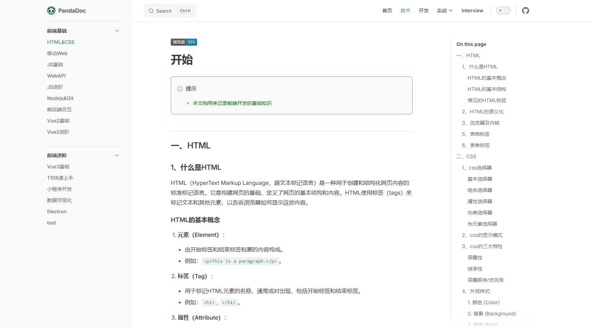
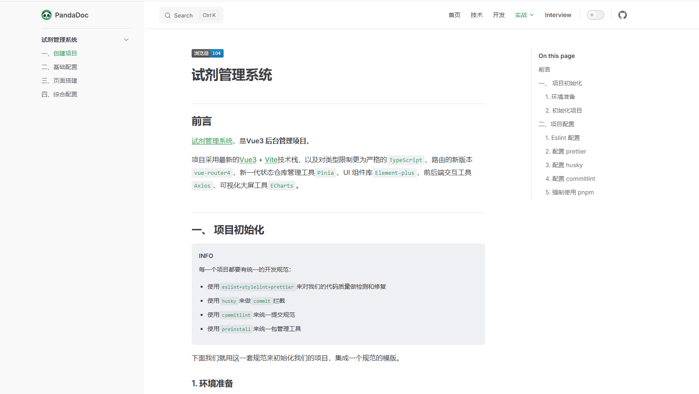
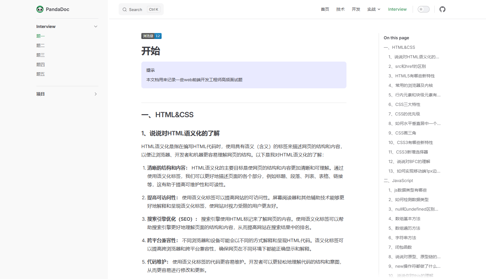

# pandaDoc

#### 介绍

欢迎来到 [PandaDoc](https://ihong-he.github.io/panda-doc/) —专为前端开发者打造的知识宝库与成长平台！无论你是编程世界的新手小白，还是寻求突破的进阶开发者，这里都是你理想的学习与交流空间。

- 访问地址：https://ihong-he.github.io/panda-doc/
- 首页
  

- 前端笔记
  

- 项目实战
  

- 面试模块
  

#### 软件架构

项目基于[VitePress](https://vitepress.dev/zh/)，VitePress 获取用 Markdown 编写的内容，对其应用主题，并生成可以轻松部署到任何地方的静态 HTML 页面。并且项目使用了 vue3 和[elementPlus](https://element-plus.org/zh-CN/)，可以更好的自定义页面内容。

#### 安装教程

> 提前安装运行环境 [nodejs](https://nodejs.org/en)，版本号`>=18`

1. 安装

   ```bash
   # or pnpm or yarn
   npm install
   ```

2. 运行

   ```bash
   npm run dev
   ```

3. 打包

   ```bash
   npm run docs:build
   ```
   `npm run build` 是等价别名，与 CI 中使用的命令保持一致。

> [!WARNING]
> 如果部署到非根路径，只需修改 `docs/.vitepress/config.js` 顶部的 `BASE` 常量：`favicon` 显式引用它，图片预览组件通过 `withBase()` 自动跟随。

4. 自动化部署

仓库已配置 [`.github/workflows/deploy.yml`](./.github/workflows/deploy.yml)：推送 `main` 分支，或在 Actions 页手动触发，即自动构建并发布到 GitHub Pages。更多说明参照 [GitHub Pages 部署指南](https://vitepress.dev/zh/guide/deploy#github-pages)。

关键配置：

- `fetch-depth: 0`：启用 `lastUpdated` 需要完整 git 历史
- `run: npm run docs:build`：构建命令需与 `package.json` 保持一致
- `path: docs/.vitepress/dist`：上传的构建产物目录
- `docs/public/.nojekyll`：避免 GitHub Pages 的 Jekyll 忽略下划线开头的资源

#### 使用说明

1.  `config` 文件配置项目，参照 [vitepress 配置](https://vitepress.dev/zh/reference/site-config)
2.  在 `theme` 文件夹自定义主题
3.  `public` 文件夹存放静态资源
4.  `.github/workflows` 文件配置 github 自动化部署

#### 参与贡献

1.  Fork 本仓库
2.  新建 Feat_xxx 分支
3.  提交代码
4.  新建 Pull Request
